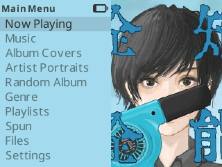
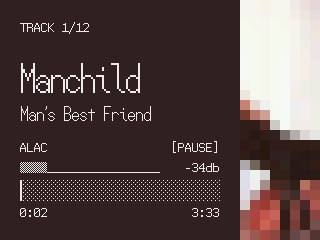
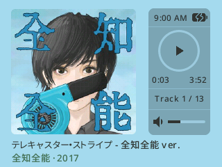

# PodBox themes

More themes for [PodBox](https://github.com/anthonyfletcher/podbox), the
firmware for the iPod Video and iPod Classic. They are not part of PodBox's
releases: Scrim ships with the firmware, and Themify 2 and iClassic Square are
on its [Themes release](https://github.com/anthonyfletcher/podbox/releases/tag/Themes).

## Installing

1. Download this repository: **Code > Download ZIP**, then unzip it.
2. Copy a theme's `.rockbox` folder (for example `jive/.rockbox`) to the root
   of the iPod, the same way you installed PodBox. Each carries the fonts it
   needs, so they can be installed in any order and on their own.
3. On the iPod, choose `Settings > Appearance > Load Theme` and pick the theme.

## Obsede' 2

By Serge Fahnenstell. [More](obsede_2/README.md)

## Bony

Based on BONES by Chuck Lardo. [More](bony/README.md)

## Jive

By James Stevenson. [More](jive/README.md)

## Licences

Obsede' 2 and Jive are licensed under
[CC BY-SA 3.0](https://creativecommons.org/licenses/by-sa/3.0/deed.en), Bony
under [CC BY-SA 4.0](https://creativecommons.org/licenses/by-sa/4.0/deed.en).
The fonts each theme carries sit beside their licence texts in its
`.rockbox/fonts/`, and its README names them.
